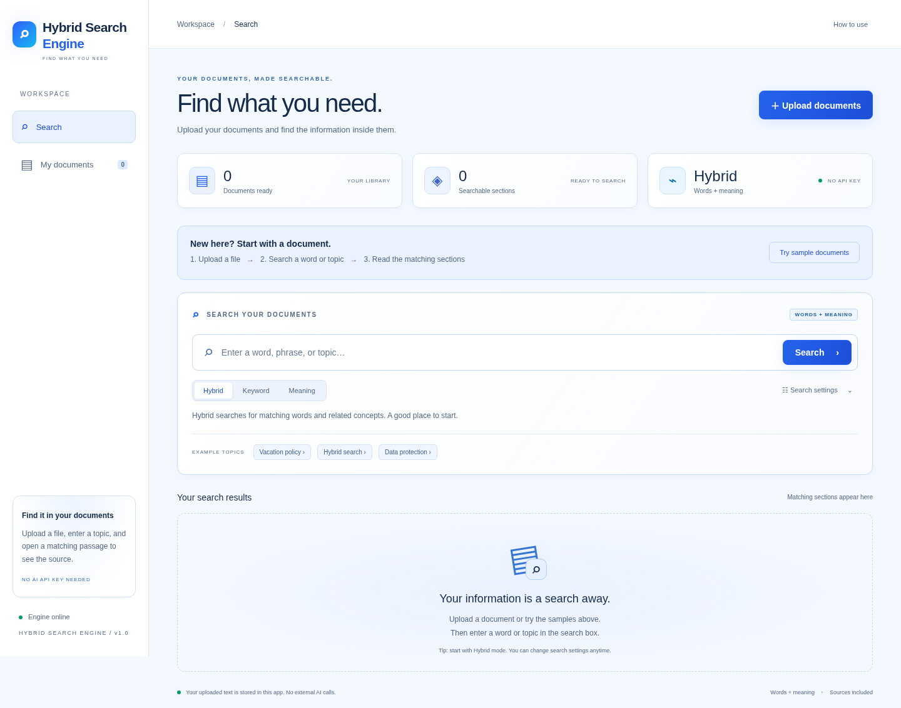

# Hybrid Search Engine — Hybrid document search

A working document retrieval app with local SQLite, serverless PostgreSQL storage, and a white-and-blue UI. Upload documents, search using keywords and related concepts, inspect source passages, and export citation-bearing evidence for RAG development.



## Run

Requires Python 3.12. No credentials, GPU, Node.js, external database, or model downloads are required.

```bash
cd /workspace/Hybrid-Search-System-RAG
python -m venv .venv
.venv/bin/python -m pip install -r requirements.lock
.venv/bin/python -m uvicorn app.main:app --host 127.0.0.1 --port 8000
```

Use the application on port 8000 in your local development environment. `/docs` serves the interactive OpenAPI reference. `RAG_DATA_DIR` selects the storage directory (default: `data` relative to the working directory). The current workspace includes three removable demo documents loaded during validation.

## What you can do

- Upload multiple files or drag them into the upload dialog; each file reports its own ingestion result.
- Read PDF, DOCX, PPTX, XLSX, TXT, Markdown, CSV, JSON, HTML/HTM, and RTF. Text must be UTF-8; PDF text must be selectable. Office tables, slide text, and worksheet values are included.
- Switch between BM25 keyword search, local latent semantic analysis (LSA), and weighted hybrid retrieval.
- Adjust semantic weight, result count, minimum rank score, document filter, chunk size, and overlap.
- Inspect matching excerpts and full source passages with document names and passage numbers.
- Copy the top three passages as JSON evidence for downstream RAG pipelines.
- Review indexed documents and permanently delete their extracted contents.
- Retain the index across restarts using SQLite. The app stores extracted text and metadata; it does not retain the original binary uploads.

**Scope:** this is a complete local retrieval and evidence-extraction application. It does not include an LLM answer generator. LSA is a corpus-trained semantic technique, with transparent synonym expansion for a few common concepts; it is less capable at broad paraphrases than pretrained sentence embeddings. Search relevance needs evaluation on your own corpus. This is a single-user development service, with no authentication or tenant isolation. Keep it bound to loopback until access controls are added.

## Parameters

| Parameter | Default | Valid values / effect |
|---|---:|---|
| `mode` | `hybrid` | `keyword`, `semantic`, or `hybrid` |
| `alpha` | `0.5` | 0–1; semantic weight in hybrid mode, keyword weight is `1-alpha` |
| `top_k` | `5` | 1–30 passages, potentially several from one document |
| `min_score` | `0` | 0–1; retains results strictly above this rank score |
| `document_id` | none | Restricts retrieval to a document; absent ID yields no results |
| `chunk_size` | `180` | 60–600 words, used at upload time |
| `overlap` | `35` | 0 to `chunk_size-1` words, used at upload time |

Rank scores are normalized reciprocal-rank values, **not probabilities or confidence estimates**. Changing chunk parameters affects new uploads only. Delete and re-upload a document to re-chunk it. Duplicate uploads are separate documents.

## API example

```bash
curl -F 'file=@handbook.pdf' 'http://127.0.0.1:8000/api/documents?chunk_size=180&overlap=35'
curl -H 'Content-Type: application/json' -d '{"query":"vacation policy","mode":"hybrid","alpha":0.5,"top_k":5}' http://127.0.0.1:8000/api/search
curl http://127.0.0.1:8000/api/documents
```

Endpoints: `GET /api/health`, `GET /api/documents`, `POST /api/documents`, `DELETE /api/documents/{id}`, `POST /api/search`. Search returns ranked `results`, the top three citation-bearing `evidence` entries, timing, and engine metadata. Validation failures use structured HTTP errors.

## Test

```bash
.venv/bin/python -m pytest -q
.venv/bin/python -m pip check
```

The backend suite tests real generated Office and PDF documents, invalid files, size limits, parameter validation, overlap, synonym retrieval, rank fusion endpoints, filters, deletion, and restart persistence. See [validation evidence](docs/VALIDATION.md), [architecture and limitations](docs/ARCHITECTURE.md), and [user review guide](docs/USER_REVIEW.md).

Browser validation (optional development dependency):

```bash
.venv/bin/python -m pip install playwright==1.58.0
# Install a Chromium browser if not already available:
.venv/bin/python -m playwright install chromium
.venv/bin/python tests/browser_check.py
```

The browser check starts an isolated temporary server and database; it never modifies your normal library. On this cloud environment it uses the existing `/usr/bin/chromium`. Override with `CHROMIUM_PATH` when needed.

## Repository map

- `app/main.py` — API, persistence, upload validation, evidence extraction
- `app/parsers.py` — file-format extraction
- `app/engine.py` — chunking, BM25, LSA, weighted reciprocal rank fusion
- `app/static/` — responsive accessible HTML/CSS/JavaScript interface
- `tests/` — automated API, retrieval, parser, and browser checks
- `requirements.txt` — direct dependencies; `requirements.lock` — full installed dependency pins

No external fonts, scripts, analytics, or AI requests are needed by the application. Back up the SQLite database while the service is stopped. Do not commit extracted user data.

## Deploy to Vercel

See [GitHub and Vercel deployment](docs/DEPLOYMENT.md). Vercel requires a persistent PostgreSQL `DATABASE_URL`; local SQLite is not used in serverless deployments. Uploads are limited to 4 MiB on Vercel.

The interface includes a first-use guide, **How to use** help, plain-language search mode explanations, **My documents**, and resettable **Search settings**. The **Meaning** mode maps to the API's `semantic` mode.

## Search accuracy investigation

See [accuracy findings and before/after results](docs/ACCURACY_REPORT.md). A small synthetic diagnostic fixture and clinic-location regression tests are included; these do not establish accuracy on your own documents. Run `.venv/bin/python scripts/evaluate_retrieval.py --output /tmp/retrieval-evaluation.json` to reproduce the current diagnostic results. Search now includes filenames and warns about missing query words. Previously uploaded documents must be re-uploaded to benefit from preserved section line breaks and corrected DOCX paragraph/table order.
